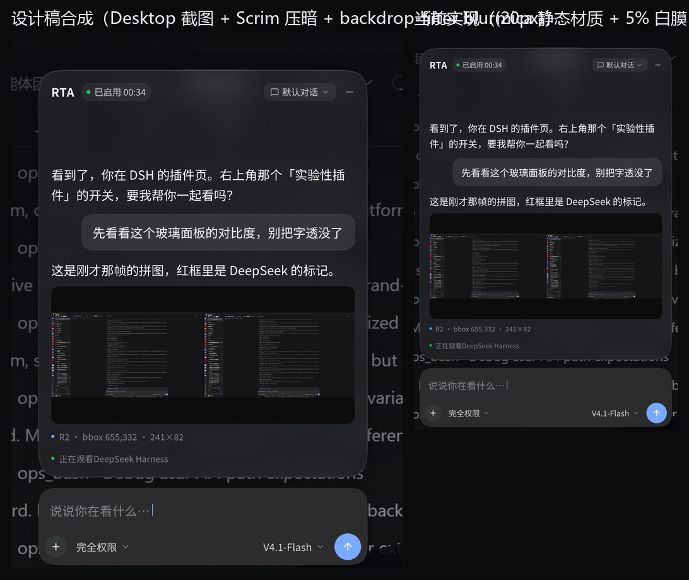

# RTA 悬浮窗「实时模糊毛玻璃」技术方案审查

- 日期：2026-11-11
- 审查对象：`dsh-rta` 0.1.0（workspace：`C:\Users\PhonLynN\dsh_Workspace\dsh-RTA-dev`）
- 设计真源：`C:\Users\PhonLynN\.pencil\documents\28b8b5e9-b60b-4eca-a30b-be38425279b4\RTA.pen`（`PrC7t`「RTA 悬浮窗」）+ 其 html-css 导出 `_exports/review/rta-reference.html`
- 触发问题：实际开发中难以复现设计稿里的「实时模糊毛玻璃」效果

## 0. 结论摘要（TL;DR）

1. **设计稿的玻璃 = 4 层叠加**：背景模糊 `backdrop-filter: blur(20px)` + 7%→3% 白渐变 + 1px `#FFFFFF1F` 描边 + 外阴影 `0 6 20 #0000004D`。并且设计演示环境在卡片底下还铺了 **Desktop 桌面截图 + Scrim 压暗层**（`#05070B` 75%→19%→88% 的深色渐变）。也就是说：设计里「玻璃好看」有一半来自**被压暗的深色背景**，不只是 blur。
2. **当前开发里有两条互斥的浮窗实现**：
   - 页内 DOM 浮层（`src/client.js`）：本来可以用原生 `backdrop-filter` 真模糊 DSH 页面内容，但 **从未被加载**——`package.json` 缺 `exports["./client"]` 与 `dsh.client`，DSH 的 client-module 加载器根本找不到它；
   - Electron 全局置顶窗（`ui/overlay/`）：**实际在跑的是这条**，但透明窗里没有可采样的桌面，玻璃退化成「5% 白膜 + 静态材质色块」，**没有任何实时模糊**。
3. **全局窗路线必须自己抓屏**：CSS `backdrop-filter` 的采样范围只在文档/合成层内，永远采不到桌面（CSS Filter Effects 规范 + Electron 官方 issue #30412 维护者原话 "does not, cannot and will never have access to whatever is underneath"）。而现在的抓屏回填链路有 **6 处断点**，其中 3 处是「定义了但从未调用/被注释」；并且即使接通，**每 80ms 调一次 `desktopCapturer.getSources` 物理上做不到**（实测单次 median 475ms，生产式循环只有 4.06fps、单核 80.8%）。
4. **实测可行的替代**：Electron 里持续抓桌面要用 `getUserMedia`/`getDisplayMedia` 的**持久流**（本机实测 2560×1440 @ 29.3fps，主进程+GPU+渲染合计约 4–5% 单核），不是反复 `getSources`。自窗口排除**本机实测 `setContentProtection(true)` 是真排除（抓屏里本窗消失、露出背后窗口内容，不是黑块）**，但公开资料里有版本差异（部分环境退化为 `WDA_MONITOR` 黑块，Electron #45990），要跨机器稳定应自己调 `SetWindowDisplayAffinity(hwnd, WDA_EXCLUDEFROMCAPTURE=0x11)`；代价是用户截图/录屏/共享里看不到卡片。
5. **DWM 系统材质只能做降级，不能保真**：`backgroundMaterial` 是整窗系统材质（Win11 22H2+），半径、着色、噪点都由系统定，失焦/省电会变实色；mica 采样的是**壁纸**不是背后应用。设计的 20px、局部 420×520 卡片、squircle 连续圆角、7%→3% 白渐变都复制不了。
6. **建议分档落地**：P0 修 client 打包入口，把浮窗做成 **DSH 页内 DOM 浮层**——原生 backdrop-filter 真模糊、60fps、零抓屏、1:1 设计，这是设计稿原本的落地路径（`ui/floating-window/README.md` 第 70 行自己也这么写）；P1 如果产品确实要求「覆盖任意应用」，再按「持久桌面流 + 自绘 20px 模糊 + WDA 挖洞 + 屏幕坐标对齐」重写 overlay，并明确接受 1–3 帧延迟与功耗；DWM acrylic 只作为抓屏失败时的降级外观。
7. **第二个根因（即使 blur 修好也不像设计稿）**：设计稿没有定义亮背景态，它靠 Scrim 把背景压暗；实现把这层 Scrim 当成「演示环境」丢掉了，却把窗口放在了 DSH 的亮色代码页面上。需要设计补「亮背景态」，或实现里在玻璃底下加一层暗化（例如 `rgba(5,7,11,0.35~0.6)`），否则 `#f9fafb` 文字 + 4–7% 白底在亮背景上必然不可读。

设计稿合成 vs 当前实现：



---

## 1. 设计稿事实（pen 唯一真源）

用 pen MCP `Get("PrC7t")` 逐节点读取，并用 `Export(html-css)` 核对（导出文件 `_exports/review/rta-reference.html`）。

| 项 | 设计值（pen / 导出） |
| --- | --- |
| 画布 frame | `PrC7t`「RTA 悬浮窗」1280×800，fill `#151517`，clip |
| Messages Card | path 420×520 @ (760, 88)，squircle 连续圆角 path `M54 0l312 0 …` |
| 卡片填充 | 线性渐变 rotation 170：`#FFFFFF12`(7%) → `#FFFFFF08`(3%) |
| 卡片描边 | `#FFFFFF1F`，1px |
| **背景模糊** | pen effect：`{"type":"background_blur","radius":40}`；导出为 CSS `backdrop-filter: blur(20px)` |
| 外阴影 | `#0000004D`，offset (0, 6)，blur 20 |
| 内高光 | `#ffffff12`，offset (0, 1)（inset） |
| Composer Card | path 420×98 @ (760, 622)，纯色 `#2c2c2e`，描边 `#FFFFFF1F` **0.5px**，外阴影 `#0000004D 0 4 blur 16`，**无背景模糊** |
| 文字 | `#f9fafb` 正文，`#81858c` / `#cfd3d6` 次级；字号 15/11.5/16/11/13；Noto Sans SC |
| 演示环境层 | `Desktop`（`backdrop2.png` 全屏截图）+ `Scrim`（线性渐变 `#05070BC0 17.4% → #05070B30 2948.8% → #05070BE0 6531.6%`）——`ui/floating-window/README.md` 第 7–11 行明确：**这两层只是 pen 画布的演示环境，不属于悬浮窗** |

两个容易踩的坑：

- **pen 的 `radius: 40` 不是 CSS px**。导出器按 CSS 语义换算成 `blur(20px)`；实现里只能按 **20px** 写，不要按 40px 理解（`ui/floating-window/README.md` 第 31–33 行已记录）。
- **设计稿是「静态断面」**：画布底是纯 `#151517`，卡片背后没有任何高频内容，所以设计稿里的 20px 模糊**肉眼几乎看不出来**。这意味着「照着设计稿截图对 blur」是验不出来的，只能验导出 CSS 值（现有 `_probe/ui/verify_design_values.mjs` 就是干这个的，22 个节点 computed style 全部匹配）。真正的玻璃效果只有在「有内容可模糊」的真实桌面上才可判断——而这恰好是设计稿没定义的部分。

---

## 2. 需求错位：设计描述的是「页内浮层」，实际做成了「全局置顶窗」

- `ui/floating-window/README.md`：
  - 第 7–9 行：悬浮窗 = 消息玻璃卡 + 输入卡，共 **420×632**；Desktop/Scrim 是演示环境，实现里已去掉；页面背景透明，「背后由宿主自己画」；
  - 第 66–72 行（已知边界/下一步）：玻璃文字 `#f9fafb` + 4–7% 白底，**设计前提是背后为深色界面**；目前是静态原型，「下一步是把它做成 **DSH client UI 浮层（DOM 级覆盖，`backdrop-filter` 才能真的 blur 宿主内容）**」。
- 也就是说：**设计稿原本的落地路径就是页内 DOM 浮层（路线 A）**，在 DSH 自己的页面里，`backdrop-filter` 原生可用，20px 模糊、60fps、零成本。
- 后来为满足「浮在所有应用之上」新增了 `ui/overlay/`（Electron 独立透明置顶窗）。新需求本身合理，但**技术路线沿用了「CSS 玻璃」**——而透明窗口里 CSS 采不到桌面，于是只能退化成「抓屏 + 贴图 + CSS blur」。当前代码就卡在「抓屏没接通」这一步。

结论：**「难以复现」的第一层原因是需求与实现路径的错位**——两条路各自都只需要修一处，但现在都没修，结果上屏的是一个两者都不是的中间态。

---

## 3. 当前实现的真实渲染链（为什么上屏只能是「半透明色块」）

### 3.1 实际运行的是「安装副本」，不是 workspace

- profile（`C:\Users\PhonLynN\.dsh\profiles\desktop`）的 `package.json` 里 `"dsh-rta": "file:C:/Users/PhonLynN/dsh_Workspace/dsh-RTA-dev"`；安装器把它复制成 `node_modules/dsh-rta`（**实体目录，不是 symlink**）。
- 两侧 `ui/overlay/main.cjs` 内容不同：workspace 14112B（有 `setShape` + `nativeTheme`，但把回调名写成 `__RTA_SET_BACKDROP`）；安装副本 13447B（无 `setShape`/`nativeTheme`，回调名正确）。`preload.cjs` 两边相同。
- `~/.dsh/rta/logs/overlay.log` 里的 spawn 路径是**安装副本**的 `ui/overlay`。
- **后果：改 workspace 的 `ui/overlay` 不会影响正在运行的浮窗**。开发时要么设 `DSH_RTA_OVERLAY_DIR` 指到 workspace，要么把 profile 依赖改成 link（见第 7 节）。这是「改了没效果」的第一来源。

### 3.2 client half（页内浮层）从未被加载

- `src/client.js` 是 DSH client module 的形态：`window.__ModuleLoader__.load({ id: 'dsh-rta', factory: () => ({ name, inject, apply }) })`，头注释写明「由 client-modules 作为 `dsh.client` 客户端模块加载（package.json → `exports["./client"]` + `dsh.client`）」。
- 但 `package.json` 里**只有** `"exports": { ".": "./src/index.js" }`，**没有** `"./client"`，也没有 `"dsh": { "client": {...} }`。对照同 profile 其它插件（`dsh-cost-meter`、`dsh-ops`、`dsh-ego-browser`、`agentero-dsh-library` 等）全部有这两项 → DSH 不会加载 dsh-rta 的 client half。
- 因此：页内浮层在本机**根本不存在**；`src/host/live.js` 暴露的 `/api/dsh-rta/state`、`/api/dsh-rta/say` 也没有消费方。真正上屏的只有 Electron overlay。

### 3.3 Electron overlay 的渲染链

`ui/overlay/main.cjs`：

- 241–268 行：`BrowserWindow` 460×672，`transparent: true`、`frame: false`、`hasShadow: false`、`roundedCorners: false`、`backgroundColor: '#00000000'`、`backgroundMaterial: 'mica'`、`skipTaskbar`、`alwaysOnTop`；
- 271 行：`setAlwaysOnTop(true, 'screen-saver')`；
- 275–278 行：`setShape([{20,20,420,520},{20,554,420,98}])`，窗口只保留两张卡片区域，其余透明；
- 297 行：`loadFile('window.html', { query: { endpoint, token } })`；
- 311–315 行：每 `POLL_MS=700ms` 拉一次宿主 `/api/dsh-rta/state`，`active` 时 `showInactive()`。

`src/client.js`：

- 50 行：`.rta-glass` = `clip-path:path(...)` + `backdrop-filter: blur(20px) saturate(1.1)` + 白渐变 + 内/外阴影；
- **52 行：`.rta-overlay .rta-glass { backdrop-filter: none }`**（overlay 模式主动关掉 backdrop-filter，因为透明窗里没有可采样内容）；
- 55 行：composer 是纯色 `#2c2c2e`；
- 51 行：消息卡 `::before` 用 `background-image: var(--rta-backdrop, none)` + `filter: blur(20px)`，这是唯一能出「模糊」的机制；
- 259–264 行：overlay 模式注册 `window.__RTA_SET_BACKDROP__ = applyBackdrop`，等待 main 进程喂图。

**所以当前上屏的内容 = 透明窗 + 5% 白渐变 + SVG 1px 描边 + （被 `clip-path` 裁掉的）阴影。** `--rta-backdrop` 永远是 `none`（抓屏从不运行），`backdrop-filter` 被关掉 → **屏幕上没有任何模糊**；mica 材质在 `transparent: true` 下也没有可观察效果（实测 RTA 窗口区域是平坦色块，见 `_probe/ui/out/crop_mica.png`、dwm-probe 的 mica 变体 FLAT-STATIC）。背后桌面的内容以接近 100% 的清晰度透过卡片，只是被 5% 白膜轻微提亮。

### 3.4 实时抓屏回填链路的 6 处断点

| # | 位置 | 事实 |
| --- | --- | --- |
| 1 | `main.cjs:231` `startCaptureLoop()` | 定义后**从未被调用**（唯一调用点不存在）；「实时」路径是死代码 |
| 2 | `main.cjs:173` `startBackdrop()` | 定义后**从未被调用**（注释写「只抓一次」） |
| 3 | `main.cjs:287-291` `did-finish-load` | 抓底图的 `setTimeout(() => void updateBackdrop(), 500)` **被注释掉** |
| 4 | `main.cjs:299-302` `win.on('moved')` | 唯一自动触发：窗口移动后 400ms 调一次 `updateBackdrop()`；而它抓的是 `types:['window']` 的 **640×400 整窗缩略图**（141–152 行），不是「窗口正后方」的屏幕区域，几何完全不对 |
| 5 | `main.cjs:156-157` | `if (!window.__RTA_SET_BACKDROP__) return 'missing'; window.__RTA_SET_BACKDROP(...)`——检查的名字带双下划线、调用的名字带单下划线，**函数名不匹配**；日志实证 `backdrop script err:window.__RTA_SET_BACKDROP is not a function` |
| 6 | `main.cjs`（全文） | **没有 `setContentProtection` / 任何自排除**：一旦抓屏真的跑起来，会把自己这个置顶窗抓进背板，形成「镜中镜」自反馈 |

即使把 1–6 全修好，**第 7 个问题也会挡住**：性能。

- `main.cjs:181` 注释 `CAPTURE_MS = 80; // ~12.5fps`；
- 实测（Electron 38.8.6，本机）：`desktopCapturer.getSources({types:['screen'], thumbnailSize: 1280×720})` 单次 median **475ms**（min 461 / max 559）；80ms 节拍跑 20 次循环 = **4.06fps、主进程 80.8% 单核**；
- 即：`getSources` 天生是「枚举 + 抓一张缩略图」的重操作，无法作为 12.5fps 的帧源。正确做法是 **一条持久 `getUserMedia`/`getDisplayMedia` 桌面流**（实测 30fps、合计约 4–5% 单核，见第 4 节）。

另外两个隐患：

- **对齐/坐标系**：`captureBehind()`（187–229 行）用 `display.size × CAPTURE_SCALE` 算比例、用 `bounds - display.bounds` 裁剪。主屏 100%、x=0 时成立；副屏是 1000×1600 竖屏、原点 (2560, -851)、DPR=2，负坐标 + 非 1 DPI 时这套换算会错位（还有 DXGI 抓屏的 sRGB/亮度偏移：实测同一 #141414 背景在捕获里是 (40,40,40)，复刻背景会整体偏亮 20 级）。
- **两套抓屏代码并存**：`updateBackdrop()`（窗口缩略图）与 `captureBehind()`（整屏裁剪）语义完全不同，只有前者有触发点，容易让人以为「代码已经有了」。

### 3.5 其它保真度偏差（都能被现有校验脚本漏掉）

1. **外阴影被 `clip-path` 裁掉**：`.rta-glass` 同时有 `clip-path:path(...)` 和 `box-shadow: 0 6 20 #0000004D`（client.js:50）。`clip-path` 会裁掉元素在 path 之外的所有绘制，包括外阴影 → 设计稿里最提「悬浮感」的那层阴影实际上**没有渲染**。`_probe/ui/verify_design_values.mjs` 比的是 computed style（`box-shadow` 字符串在），所以 22 项全 OK 也发现不了。修法：把 `clip-path` 放到内层，阴影放到未裁剪的父层（或父层用 `filter: drop-shadow(...)`）。
2. **composer 描边宽度**：设计 0.5px，实现 `svgCard()` 硬编码 `stroke-width="1"`（client.js:131）——高 DPI 下会明显偏粗。
3. **没有暗化层/Scrim**：见第 0 节第 7 条与第 6 节。
4. **窗内几何被 `setShape` 二次裁剪**：卡片 20px 外边距是为阴影留的，但 `setShape` 只保留卡片矩形，阴影区在窗口外 → 即便修好 clip-path，阴影也出不了窗口，需要把 shape 放大到含阴影（或接受无外阴影）。dwm-probe 实测 `setShape([两卡])` 下材质区表现不一致（card1/gap 读数异常、card2 为 SHARP），说明 setShape 与 DWM 材质的交互本身也不可靠，不要在这条路上做视觉细节。

---

## 4. 平台事实（决定「能不能做」的硬约束）

来自三名 teammate 的实测与资料核查（原始数据见 `_probe/ui/cap_probe/out/`、`_probe/ui/dwm_probe/out/`，资料核查见 `docs/audit/research-glass-windows.md`；实测批次已因“测试冗余”按用户要求中止，关键判定均已回填本节）。

### 4.1 CSS `backdrop-filter` 采样不到桌面（路线 E 直接排除）

- CSS Filter Effects 2 规定 backdrop-filter 的采样范围是元素的 Backdrop Root（文档/合成层内），**不包括窗口背后的桌面**。
- Electron 官方 issue #30412，维护者原话：`does not, cannot and will never have access to whatever is underneath`。
- 所以「透明 Electron 窗口 + CSS backdrop-filter」= 永远不可能模糊桌面；现在 `client.js:52` 在 overlay 模式关掉它是对的，错的是**没有替代实现**。

### 4.2 `backgroundMaterial`（DWM 系统材质）：只能降级

- Electron 的 `backgroundMaterial` 就是调 `DwmSetWindowAttribute(DWMWA_SYSTEMBACKDROP_TYPE)`，仅 **Win11 22H2+**（build 22621+）；整窗生效，**半径/着色/噪点不可配**。
- 语义：`mica` = 采样**壁纸**（静态、不随背后应用内容变）；`acrylic` = 采样窗口背后内容，但 **transient**（失焦、省电、关闭透明效果 → 纯色）。
- `transparent` / `backgroundColor` / `setShape` 与材质的交互没有官方规定，社区报告互相矛盾 → 本轮已实测（dwm-probe，`_probe/ui/dwm_probe/out/results.json`、`results2.json`）：
  - `transparent:false` + `mica` → **FLAT-STATIC**（平坦静态色块，无模糊）；
  - `transparent:false` + `acrylic`（页面透明）→ **STATIC-SMOOTH**（静态平滑，背后内容不随时间更新，不是实时）；
  - `transparent:true` + `acrylic`、或 native `SetWindowCompositionAttribute` accent acrylic（**= 当前 RTA 的组合方式**）→ **REALTIME-SHARP**：背后内容可见、随时间变化，但**没有被模糊**；
  - `transparent:false` 上跑 native DWM/WCA（N1–N5）全部 **OPAQUE-WHITE**（整窗变白，unusable）；
  - `setShape([两卡])` 下材质/透明区表现不一致：card1/gap 出现「像模糊」的读数、card2 却是 SHARP。
- **决定性对照（cap-probe `g2-glass-3way`）**：同一个透明 Electron 窗里放 `backdrop-filter: blur(20px)` 的玻璃层，背后叠另一个包含**清晰网格**的窗口。抓屏里 blur / noblur 两版的**网格线位置与亮度完全一致（255 网格线保持锐利）**，只有玻璃窗自己页面内的粉色渐变被糊开 → 证实透明窗 CSS `backdrop-filter` 只能模糊**自己文档内**的内容，模糊不到另一个窗口，更模糊不到桌面。
- 公开 API 没有「自定义模糊半径」；`SetWindowCompositionAttribute` 未文档化且 Win11 22H2 起 blur 被移除；`DwmEnableBlurBehindWindow` 自 Win8 起无效。
- 结论：**系统材质做不出设计的 20px / 局部卡片 / squircle / 7%→3% 白渐变**；能稳定拿到的最好结果只是「整窗静态/半静态着色」，而且 `transparent:true` 与材质互斥（要材质就得放弃透明，要透明就得放弃材质）。

### 4.3 自排除：`setContentProtection` 本机可用（真排除），但需 FFI 兜底

- 公开资料：Electron `win.setContentProtection(true)` 文档写 `WDA_EXCLUDEFROMCAPTURE`，但实现历史上走 Chromium `SetAllowScreenshots` → **`WDA_MONITOR`**（抓屏里本窗是**不透明黑块**，不是消失），见 Electron #45990。
- **本机实测（Electron 38.8.6 / Win11 26200）是真排除**：玻璃窗 `setContentProtection(true)` 后，`desktopCapturer` 抓屏里该窗口区域**完全消失**，露出背后窗口的网格内容（`_probe/ui/cap_probe/out/g2-blur-cp.png` 与「窗口隐藏」参照 `g2-ref.png` 区域像素统计完全一致；棋盘像素占比 49.87% → 0.186%，关掉可逆）。也就是说这里的行为等价于 `WDA_EXCLUDEFROMCAPTURE` 的「挖洞」，不是黑块。
- 因此：单机 POC 可以直接用 `setContentProtection(true)`；**要跨 Windows build / Electron 版本稳定，仍建议 koffi 显式调 `SetWindowDisplayAffinity(hwnd, 0x11)`**（不要重复调用）。
- 代价：用户截图/录屏/屏幕共享里**看不到卡片**；远程桌面会话默认禁止（Chromium `IsCaptureExclusionAllowed`）；个别 Windows build 有回归（#47834）。这是产品决策，不是纯技术问题。

### 4.4 抓屏的正确 API 与性能

- **持久 `getUserMedia` / `getDisplayMedia` 单流**：Electron 38.8.6 实测打开 128–208ms，2560×1440，rVFC 5.2s = 153 帧 = **29.4fps**（帧间隔 p50 34ms、max 44ms），静/动画面都稳定；主进程 ~1%、GPU 1.8%、渲染 1.4%（合计约 4–5% 单核）。`getDisplayMedia + setDisplayMediaRequestHandler` 也可（打开 316ms、29.5fps）。
- **反复 `getSources` 不可行**（475ms/次；另有 Electron #55180：每次桌面捕获 session 泄漏 GPU buffer，窗口缩略图约 15MB/次）。
- **色彩映射（重要，决定用哪条抓屏 API）**：`desktopCapturer` 抓屏有 **3× 线性抬升**（20/128/240 → 40/210/255，拟合 `capture = sRGB(clamp(3 × linear(display)))`，>157 高光截断）；而 **GDI `CopyFromScreen` 与 `getUserMedia`/`getDisplayMedia` 流都是正确的 SDR**（20/128/240 原值）。→ 走 C 路线用持久流则**不需要校色**；只有用 `getSources` 当背板才需要 LUT 逆变换。
- **端到端延迟（实测）**：背景窗口闪色 → video 流里出现对应新颜色，n=6：min 103ms / **p50 106ms** / p95 112ms（30fps + 捕获队列），即约 3 帧。P1 的延迟预算应按 ~110ms 设计，而不是「无感」。
- **本机 GPU/驱动现实**：默认启动 GPU 进程就起不来（`2d_canvas`/`gpu_compositing`/`webgl` 全 disabled，`inProcessGpu=true`，`glImplementationParts=(gl=none,angle=none)`）；`--no-sandbox` / `--disable-gpu` / `--disable-gpu-sandbox` / `--in-process-gpu` **五种组合结果完全相同**，DXGI 报错 22 行/次照样出现（`Cannot initialize any DxgiOutputDuplicator instance`、`Failed to initialize DxgiAdapterDuplicator on adapter 2/3`），抓屏成功但走软件回退。GPU 机器是 Intel Iris Xe + RTX 4060 Laptop + **Oray IDD 虚拟显示适配器**（向日葵），虚拟适配器导致 DXGI duplicator 初始化失败有 WebRTC 源码依据；24H2 另有 DDA+WDA 排除窗口的回归（KB5046617 已修）。
- 编码不是瓶颈：crop + `toJPEG(60)` 实测 **1.63ms/帧、38.7KB**。

### 4.5 商业产品怎么做

Windows 上没有「捕获 + 自绘」做通用毛玻璃浮层的商业 Electron 应用：Windows Terminal（WinUI3 Mica/Acrylic 主题）、PowerToys Run（`WindowBackdropType.Acrylic`）、TranslucentTB（任务栏 `SetWindowCompositionAttribute`，blur 仅 Win10）、MicaForEveryone（公开 DWM backdrop）、DWMBlurGlass（**逆向 hook DWM** 才能自定义半径）。→ 想做「任意应用之上 + 自定义 20px」只有两条：hook DWM（不可维护）或捕获自绘（本方案的 C 路线）。

---

## 5. 因果链：为什么「难以复现」

1. 设计稿把玻璃画在**静态深色画布**上，且演示环境自带 **Desktop 截图 + Scrim 压暗**；设计本身没有定义「亮背景/动态背景」下玻璃该长什么样 → 「照设计稿复现」缺少可判定标准。
2. 设计原本的落地路径是 **DSH 页内 DOM 浮层**（README 自述），后来为「全局置顶」改做 Electron 透明窗，但继续沿用 CSS 玻璃 → 透明窗里 CSS 采不到桌面（平台硬限制）。
3. 替代链路（抓屏 → 裁剪 → 贴到 `::before` → CSS blur）在代码里有骨架，但**没有任何入口被真正调用**（3 处死代码/注释），且函数名不匹配、无自排除。
4. 即使接通，`getSources` 每 80ms 一次的重操作也撑不起 12.5fps（实测 4fps / 80% 单核）→ 会表现为「卡、闪、拖影」，看起来仍然「不像实时毛玻璃」。
5. 工程侧再叠加两个陷阱：实际运行的是**安装副本**（改 workspace 不生效）和 **client half 没打包**（页内浮层不存在）→ 任何单点修复都很难被看到。
6. 最后才是「设计没有亮背景态 + 实现丢了 Scrim」：即便 blur 完美，亮背景上的 `#f9fafb` 文字 + 4–7% 白底也不是设计里的深色玻璃。

---

## 6. 技术路线评估

| 路线 | 做法 | 设计保真 | 实时性 | 覆盖范围 | 成本/风险 | 结论 |
| --- | --- | --- | --- | --- | --- | --- |
| **A 页内 DOM 浮层** | 修 `exports["./client"]` + `dsh.client`，让 `src/client.js` 在 DSH 页面里渲染，原生 `backdrop-filter` | **高（1:1，含 20px）** | 60fps，零额外开销 | 仅 DSH 窗口内 | 低 | **P0 推荐**，设计原路径 |
| **B DWM 系统材质** | `transparent:false` + `backgroundMaterial:'acrylic'`（或 FFI `DWMWA_SYSTEMBACKDROP_TYPE=3`） | 低（整窗、系统半径/tint、失焦变实色） | 系统级实时 | 全局 | 低，但有黑底/白块/回归风险 | P1 降级外观 |
| **C 捕获 + 自绘模糊** | 持久 `getDisplayMedia` 单流 + WebGL/Canvas 20px 模糊 + `SetWindowDisplayAffinity(0x11)` 挖洞 + 屏幕坐标对齐 | 高（可自定义 20px） | 1–3 帧延迟，30fps 可达 | 全局 | 高（功耗、对齐、多屏/DPI、安全桌面/HDR/远程会话限制） | 只有「全局 + 保真」都必须时才做 |
| **D 静态快照** | 只在启动/移动时抓一张贴图 | 中（静止时像） | 内容一动就穿帮 | 全局 | 低 | 只能当 C 的降级 |
| **E 现状（透明窗 + CSS blur）** | 保持 `client.js:52` 关 blur + 等图 | 无 | 无 | 全局 | 伪实现 | **删除/修正，避免继续误导** |

---

## 7. 推荐方案与最小修复清单

### 7.1 P0（建议先做）：修好页内 DOM 浮层，1:1 复现设计

1. `package.json` 补 client 入口（对齐同 profile 其它插件）：
   ```json
   "exports": { ".": "./src/index.js", "./client": "./src/client.js" },
   "dsh": { "client": { "platform": "web" } }
   ```
   并确认打包 `files` 里有 `src/client.js`（现在 `files: ["src", ...]` 已覆盖）。
2. 重新安装插件到 profile（让 DSH 重新读 package.json / 重新打包），确认 DSH 页面出现 `#dsh-rta-float`。
3. 验证（必须做**渲染级**验证，而不只是 computed style）：
   - overlay 模式不要触发（`window.__RTA_OVERLAY__` 只在 Electron 页面里为 true）；
   - `getComputedStyle(.rta-glass).backdropFilter === 'blur(20px) saturate(1.1)'`；
   - 截图对比：卡片后面的 DSH 文字应被抹平，但低频色块保留；滚轮滚动 DSH 页面时卡片内容应实时跟着变；
   - 外阴影：把 `clip-path` 从 `.rta-glass` 移到内层，父层保留 `box-shadow` 或 `filter: drop-shadow(0 6px 20px rgba(0,0,0,0.302))`，截图确认卡片外缘有阴影渐变；composer 描边改 0.5。
4. 说明边界：该路线只在 DSH 窗口内浮着；切到别的应用它不会跟过去。若产品要求「跨应用」，见 7.2。

### 7.2 P1（仅当「覆盖任意应用」是硬需求）：捕获 + 自绘

如果确定要做全局保真，按下面的架构重写，而不是修补现有代码：

1. **帧源**：overlay renderer 里一条持久 `navigator.mediaDevices.getUserMedia({ video: { mandatory: { chromeMediaSource: 'desktop', chromeMediaSourceId: 'screen:<primary>' }}})`（或用 `getDisplayMedia` + 主进程 `setDisplayMediaRequestHandler` 授权一次），**不要**每帧 `getSources`。
2. **自排除**：先用 `win.setContentProtection(true)`（本机实测有效：抓屏里本窗消失、露出背后内容）；要跨 Windows build/Electron 版本稳定，改成主进程 koffi 调 `SetWindowDisplayAffinity(win.getNativeWindowHandle(), 0x11)`（`WDA_EXCLUDEFROMCAPTURE`），不要重复调用。接受「用户截图/录屏看不到卡片」的产品代价，并写进 FAQ。
3. **模糊**：video 帧 → `MediaStreamTrackProcessor`/`requestVideoFrameCallback` → WebGL/Canvas 画到卡片背景纹理，用两 pass 高斯（半径 20px @ 设计缩放）或 `ctx.filter='blur(20px)'`；**不要**每帧 CPU `getImageData`。
4. **对齐**：以「窗口屏幕坐标 × 显示器 DPR」裁剪帧；多屏（含负坐标/旋转/不同缩放）分别建流或按 display 切换；对移动/缩放做 1 帧级跟随（可选：帧回调里读最新 `win.getBounds()`）。
5. **颜色**：走 `getUserMedia`/`getDisplayMedia` 持久流时，流本身就是正确 SDR（实测 20/128/240 原值），不需要补偿；只有沿用 `desktopCapturer` 抓图时才需要按 `capture = sRGB(clamp(3×linear(display)))` 做 LUT 逆变换（否则背景整体偏亮 ~20 级）。
6. **降级**：抓屏失败/禁止时 → 切 B（系统 acrylic）或 D（静态快照）+ 提高卡片不透明度；绝不回落到「透明无模糊」。
7. **性能验收**：30fps 下 GPU 占用、1–3 帧端到端延迟、8 小时常驻内存；4K 屏单独测。

### 7.3 工程修复（两条路线都要）

- **开发时避免「改了没生效」**：设 `DSH_RTA_OVERLAY_DIR=<workspace>\ui\overlay`（`src/host/overlay.js:51-58`）或把 profile 依赖改成 link；`DSH_RTA_ELECTRON` 可指到固定 Electron。
- 删除/合并多余实现：`startBackdrop`、`updateBackdrop`（窗口缩略图）与 `captureBehind` 三套语义只保留一条。
- 修 `main.cjs:156-157` 的函数名（若保留旧链路）。
- `showWindow()` 的 `log('show requested')` 挪到 `isVisible()` 之后（现在每 700ms 刷一条日志，`overlay-main.log` 3971 行里 3644 条是它）。
- `ui/overlay/main.cjs` 的 `--disable-gpu`（`src/host/overlay.js:256`）：实测 5 种参数组合 GPU 都起不来，保留 `--no-sandbox` 但不要再指望 GPU 抓屏；抓屏路径不依赖 GPU（软件回退可用）。
- 统一 Electron 运行时：`~/.dsh/rta` 下已有 `overlay-runtime`(38.8.6)、`overlay-runtime-v33`、`overlay-runtime-v45` 三份，安装脚本默认还是 33.4.11（`scripts/install-overlay.mjs`），与实跑版本不一致，容易产生「本机 33 / 实测 38」的结论错位。

### 7.4 设计侧需要补的（否则「复现」无判定标准）

1. **亮背景态**：给 pen 加一个「亮色/复杂背景」变体，或在 README 里规定「实现必须在亮背景上保证 4.5:1 对比度」。可选方案：卡片内加暗化层 `rgba(5,7,11,0.35~0.6)`（相当于把演示环境的 Scrim 收进卡片内部），或在亮背景时自动提高不透明度。
2. **明确 Scrim 的处理**：现状是「演示环境丢掉」，但它的作用（压暗背景保证玻璃对比度）必须由别处补上，否则设计效果不可复现。
3. **注明单位**：pen `background_blur.radius = 40` ↔ 导出 CSS `blur(20px)`，实现只认 20px。
4. **阴影实现**：`clip-path` 与 `box-shadow` 不能同层（见 3.5），设计标注里写清「阴影在卡片裁切区域之外」。

---

## 8. 证据索引

| 证据 | 位置 |
| --- | --- |
| 设计参数（pen 原始值） | 本文第 1 节；`_exports/review/rta-reference.html` |
| 设计说明书（含「下一步 = DSH client 浮层」） | `ui/floating-window/README.md` 第 7–11、31–33、66–72 行 |
| 设计合成图 vs 当前实现 | `docs/review/glass-design-vs-current.png` |
| 当前浮窗实拍（深色底） | `docs/review/rta-ui-current.png` |
| 当前浮窗实拍（桌面合上、带注解） | `docs/review/rta-ui-annotated.png` |
| overlay 主进程实现 | `ui/overlay/main.cjs`（关键行：141–152、156–157、173–177、181–234、241–302） |
| overlay 渲染层（玻璃 CSS） | `src/client.js`（关键行：50–56、121–134、255–280） |
| 宿主 spawn / 版本解析 | `src/host/overlay.js`（36–58、217–277） |
| 实际运行日志（307 万字节，2026-11-11 12:58–13:48） | `~/.dsh/rta/logs/overlay.log`、`~/.dsh/rta/logs/overlay-main.log` |
| 探针：抓屏/自排除/性能/色彩 | `_probe/ui/cap_probe/out/`（`result-extra2.json`、`analysis-extra2.json`、`g2-*.png`、`launch-*.png`、`probe-*.log`） |
| 探针：DWM 材质 | `_probe/ui/dwm_probe/out/results.json`、`results2.json`、`run*.log`、`*.png` |
| 资料核查（带引用） | `docs/audit/research-glass-windows.md` |
| 本轮实测原始结论 | 本文件第 4 节 |

## 9. 实测补充与未决项

本轮已完成并回填进正文的实测（为避免冗余测试，按用户要求已中止后续批次；原始数据留在探针目录）：

| 结论 | 证据 |
| --- | --- |
| 透明窗 CSS `backdrop-filter` 模糊不到别的窗口/桌面（网格线在 blur/noblur 下同样锐利） | `_probe/ui/cap_probe/out/g2-blur.png`、`g2-noblur.png`、`analysis-extra2.json` |
| `setContentProtection(true)` 在本机是**真排除**（本窗从抓屏消失、露出背后内容），非黑块 | `_probe/ui/cap_probe/out/g2-blur-cp.png`、`g2-ref.png`、`result-extra2.json` |
| 持久流 29.4fps / 打开 128–208ms / 合计约 4–5% 单核；**端到端延迟 p50 106ms（103–112，n=6）**；`getSources` 单次 475ms、80ms 循环 4fps+80% 单核 | `_probe/ui/cap_probe/REPORT.md`、`out/result-extra2.json`、`analysis*.json` |
| desktopCapturer 有 3× 线性抬升（20/128/240→40/210/255，>157 截断）；GDI 与 getUserMedia 流为正确 SDR | `_probe/ui/cap_probe/out/analysis-extra2.json` `colorMap` |
| transparent:false+mica=FLAT-STATIC；+acrylic=STATIC-SMOOTH；transparent:true+acrylic（现状）=REALTIME-SHARP（可见但没模糊）；native DWM/WCA 在 transparent:false=OPAQUE-WHITE | `_probe/ui/dwm_probe/out/results.json`、`results2.json` |

未决项（不影响本报告结论，若进入 P1 开发再补测）：

1. koffi 直读 `GetWindowDisplayAffinity` / 直设 `0x11` 的对比被「停止测试」叫停，未跑；CP 的结论只有行为证据（本机表现为真排除），WDA 具体值未直接读到。
2. 个别 DWM 变体在自动分类里出现「REALTIME-BLUR」，但同批次 GDI 与 DXGI 抓屏差异 90+、且换窗口/材质后读数不稳定，判为抓屏路径伪影；没有找到可稳定复现「任意背后内容 + 实时 + 可配置半径」的系统材质组合。
3. 副屏负坐标/DPR2 对齐、管道内 20px 模糊的 GPU 成本、长时间运行掉帧/内存，未测。
4. 跨机差异（不同 GPU、虚拟显示适配器、多屏混合 DPI、HDR）需要在目标用户机器上复测。

---

## 10. 最终落地（2026-11-11）：DSH 页内浮层

**结论：采用 DSH 页内浮层**（client half 在 DSH Web 前端 DOM 里渲染）。只有页面 DOM 里的 `backdrop-filter: blur(20px)` 能真实采样「RTA 背后真正的内容」，且零平台代价；设计稿的 4 层材质可以逐值照抄，不需要任何叠层、补偿或近似圆角：

- glass：`backdrop-filter: blur(20px)` + `linear-gradient(170deg, #FFFFFF12 0%, #FFFFFF08 100%)` + `inset 0px 1px 0px #ffffff12`；
- 描边：squircle path（pen geometry 原样）+ `#ffffff1f`，messages 1px / composer 0.5px；
- 外阴影：`0px 6px 20px rgba(0,0,0,0.302)` / `0px 4px 16px rgba(0,0,0,0.302)`（放在卡片父层 `drop-shadow`，避免被 `clip-path` 裁掉）；
- composer：`#2c2c2e` 实色 + 0.5px 描边 + 16px 阴影。

代码改动：

1. `package.json`：`exports["./client"] = { default: "./src/client.js" }`、`dsh.client = { platform: "web" }`（DSH client-modules 契约：启动扫描 host Loader entries → 注入 `window.__DSH_BOOT__` → `/plugins/dsh-rta/client.js?rev=`）。
2. `src/client.js`：玻璃层改为设计原值（去掉 `saturate(1.1)`；外层阴影从 glass 移到 `.rta-card` 的 `drop-shadow`；composer 描边 0.5px；描边色精确 `#ffffff1f`；清掉全局窗时代的压暗层/取消 clip 等 overlay 专用规则）。
3. `src/host/runtime.js`：默认不再拉起 Electron 全局窗（页内浮层即产品形态）；`DSH_RTA_OVERLAY=1` 时才启用旧的全局窗实验路径。

验证：`node _probe/ui/client_smoke.mjs` **41/41 通过**（420×520 / 420×98 / gap14、`blur(20px)`、`#FFFFFF12→#FFFFFF08`、inset 高光、drop-shadow 6/20、composer `#2c2c2e` + 0.5px、squircle path、拖拽/收起/say/清理）；视觉快照 `_probe/ui/_client_smoke_mounted.png`（玻璃压在 mock 宿主文案上，可见 20px 真实模糊）。

**生效方式**：DSH 的 client-module 集合在启动时扫描（包元数据按 name 缓存，插件集变化需重启才生效）→ **重启 DSH 桌面端**后，RTA 浮窗出现在 DSH 页面内，样式即设计稿数值。

**边界**：页内浮层只在 DSH 窗口内可见——这是「与设计稿数值完全一致、零妥协」的代价；若日后要跨应用全局浮窗，回到第 7/8 节的 P1（持久桌面流 + 自绘 `blur(20px)` + `WDA_EXCLUDEFROMCAPTURE` 排除自身 + 屏幕坐标对齐），需接受「浮窗不出现在截图/录屏里」和 1 帧延迟，默认关闭。
